# Lumina E-Commerce (mentorship)

A Flutter e-commerce app with email/password authentication, a product catalog, and full English / Arabic localization. Built with a feature-first architecture and Cubit (flutter_bloc) for state management.

## Screenshots

UI designs created in Stitch.

### Onboarding

| Splash | Onboarding 1 | Onboarding 2 | Onboarding 3 |
|:---:|:---:|:---:|:---:|
| 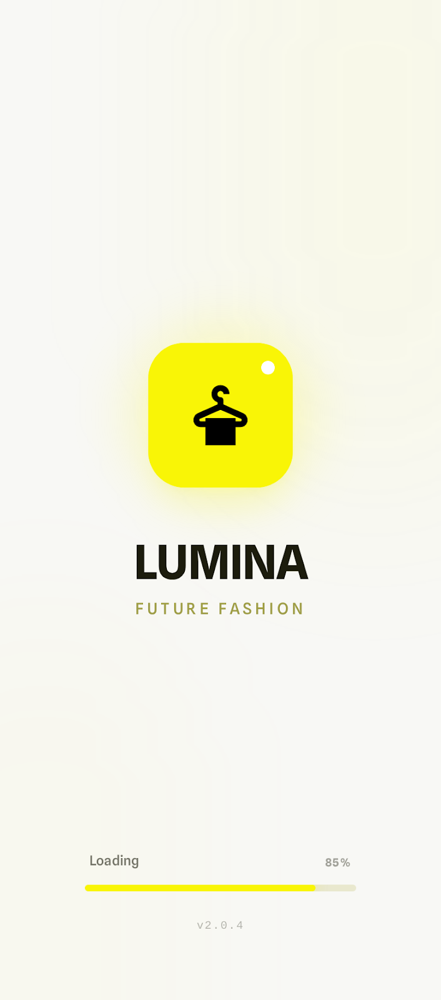 | 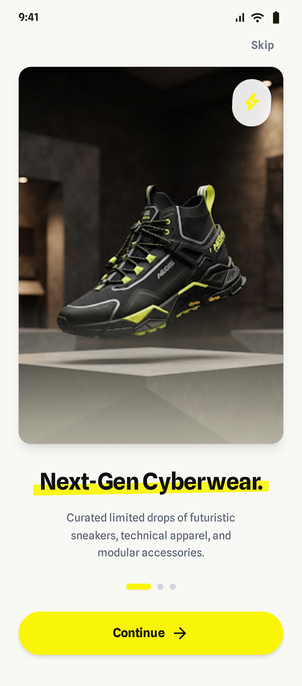 |  |  |

### Authentication

| Login | Register | Verify Account | Forgot Password |
|:---:|:---:|:---:|:---:|
|  |  |  | 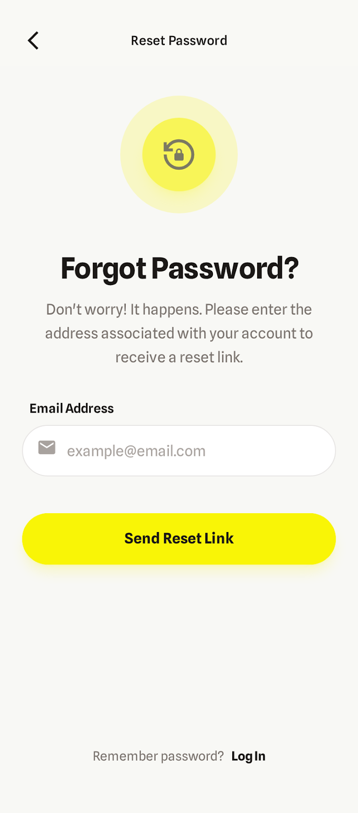 |

| Reset Password |
|:---:|
| 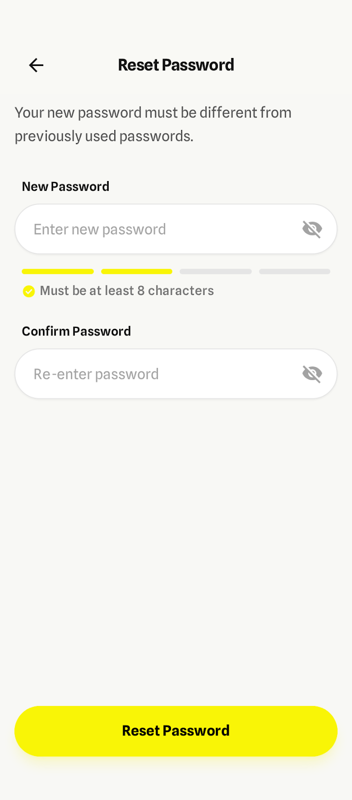 |

### Shopping

| Home | Products by Category | Search Filters | No Search Results |
|:---:|:---:|:---:|:---:|
|  | 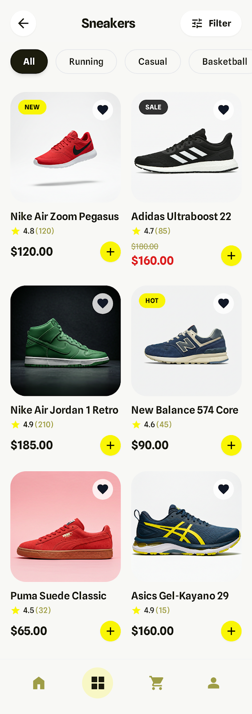 | 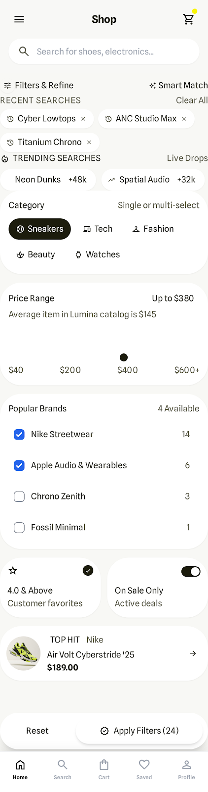 | 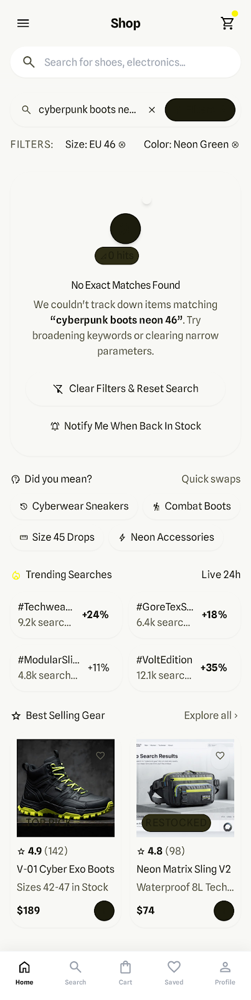 |

| Product Details | Write a Review | Wishlist |
|:---:|:---:|:---:|
|  |  |  |

### Cart & Checkout

| Shopping Cart | Empty Cart | Checkout & Payment | Payment Failed |
|:---:|:---:|:---:|:---:|
|  | 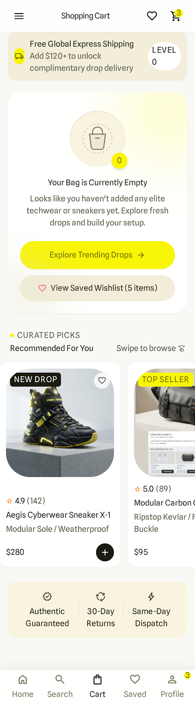 |  | 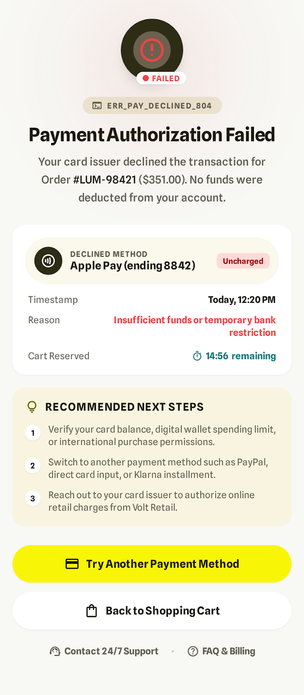 |

| Order Success & Tracking |
|:---:|
|  |

### Orders

| Order History | Order Details | Return & Refund |
|:---:|:---:|:---:|
|  | 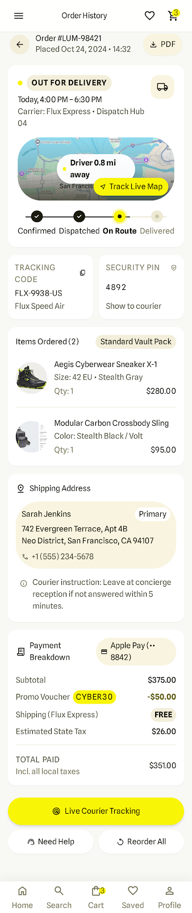 | 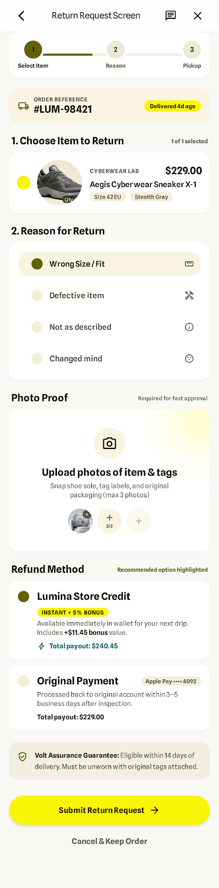 |

### Account

| Profile | Edit Profile | Shipping Addresses | Add Address |
|:---:|:---:|:---:|:---:|
|  | 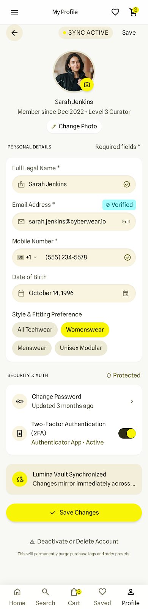 | 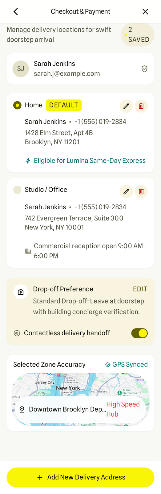 | 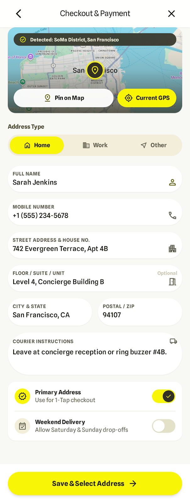 |

| Payment Methods | Vouchers & Offers | VIP Rewards | Notifications |
|:---:|:---:|:---:|:---:|
| 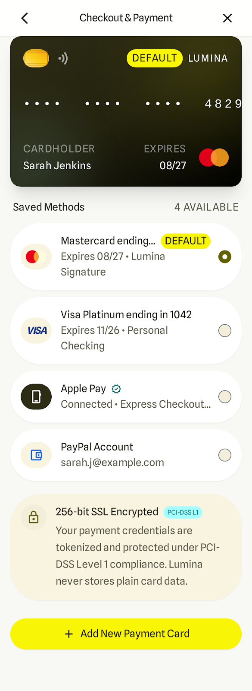 | 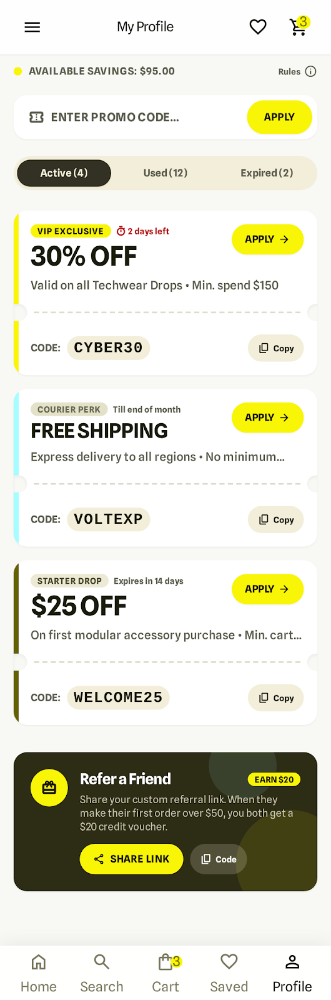 | 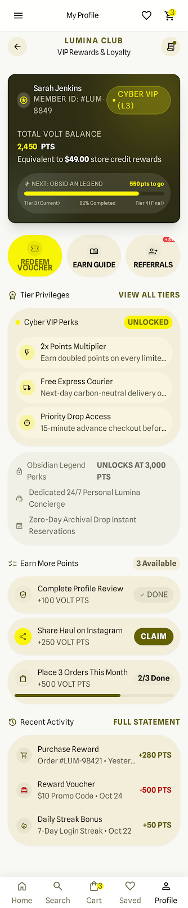 |  |

### Support & States

| Help & Support | Live Chat | Offline State | Store Prototype |
|:---:|:---:|:---:|:---:|
| 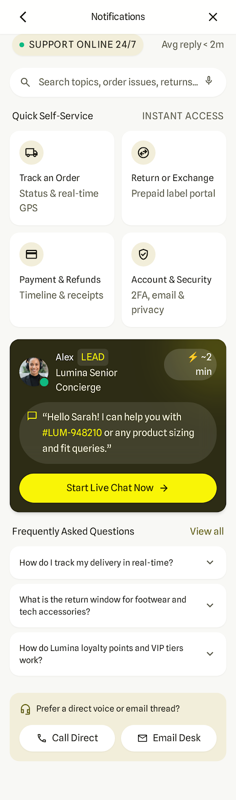 | 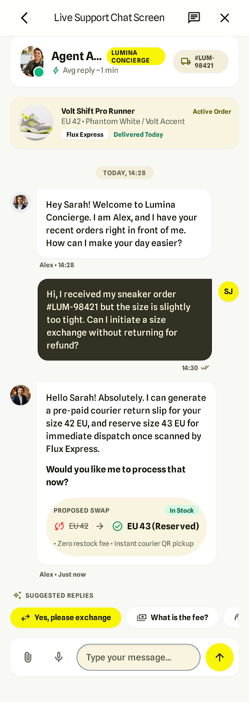 | 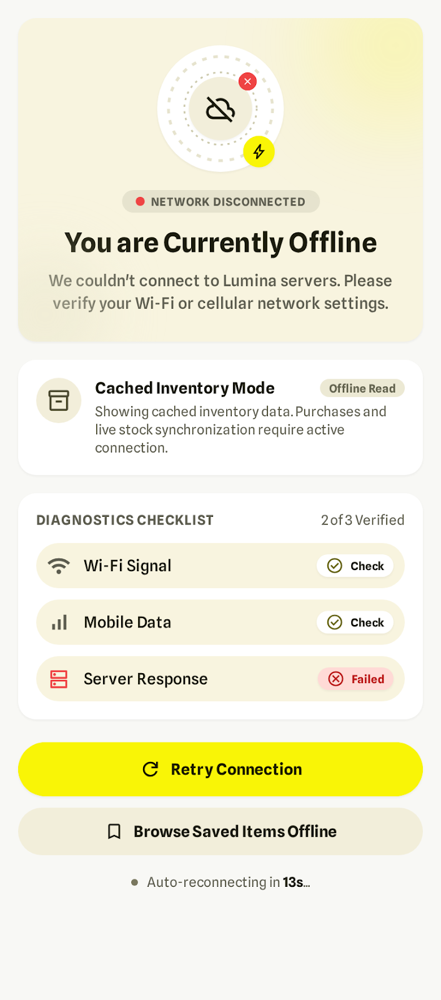 | 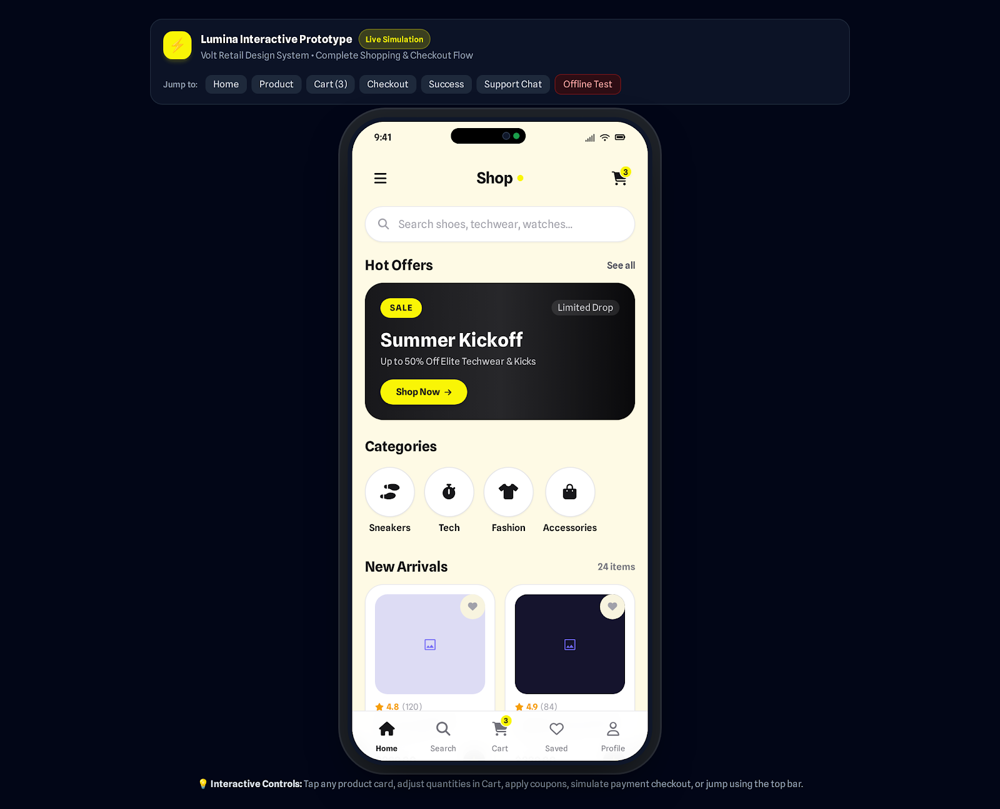 |

## Features

- **Authentication**: register, verify email, and log in. Access and refresh tokens are stored locally with `shared_preferences`, and the app opens straight to Home when a token exists.
- **Products**: paginated product list and a product details screen.
- **Localization**: English and Arabic (`lib/l10n`), generated with Flutter's `gen-l10n`.
- **Responsive UI**: sizes adapt to the screen with `flutter_screenutil` (design size 390 x 844), and the Cairo font comes from `google_fonts`.
- **Networking**: a shared `Dio` client with centralized error handling.

## Tech Stack

| Area | Package |
|---|---|
| State management | `flutter_bloc` (Cubit) |
| Networking | `dio` |
| Local storage | `shared_preferences` |
| Responsive sizing | `flutter_screenutil` |
| Fonts | `google_fonts` |
| Localization | `flutter_localizations`, `intl` |

## Project Structure

```
lib/
├── main.dart
├── core/
│   ├── localization/   # l10n extension
│   ├── network/        # Dio client + API constants
│   ├── routes/         # route names + router
│   ├── storage/        # token storage
│   ├── theme/          # colors + text styles
│   ├── utils/          # validators, snackbar
│   └── widgets/        # shared widgets (button, text field)
├── features/
│   ├── auth/
│   │   ├── data/           # service + models
│   │   └── presentation/   # cubit + views (login, register, verify email)
│   └── products/
│       ├── data/           # service + models
│       └── presentation/   # cubit + screens (home, product details)
└── l10n/                   # .arb files + generated localizations
```

## Getting Started

### Prerequisites

- Flutter SDK with Dart `^3.13.3`

### Run

```bash
git clone https://github.com/Ahmed-Elzaher/mentorship.git
cd mentorship
flutter pub get
flutter run
```

The localization files are generated automatically (`generate: true` in `pubspec.yaml`). To regenerate them manually:

```bash
flutter gen-l10n
```

### Test

```bash
flutter test
```

## Backend

The app talks to a REST API configured in `lib/core/network/api_constants.dart`:

| Group | Endpoints |
|---|---|
| Auth | `auth/register`, `auth/verify-email`, `auth/login`, `auth/refresh-token` |
| Products | `products`, `products/{id}` |
| Categories | `categories`, `categories/{id}` |

To point the app at a different backend, change `baseUrl` in that file.
